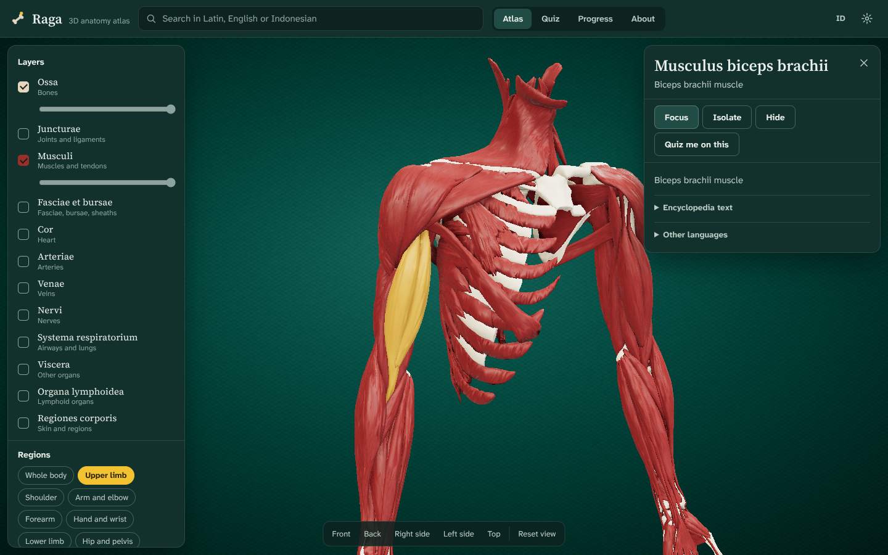

# Raga

Raga is a free 3D anatomy atlas with Latin short-answer quizzes. You can turn the body around, peel it layer by layer, click any structure to read its Latin name and the facts you get examined on, then test yourself the way an OSPE station does: a pin on a specimen and an empty line for the name.

**Open it:** https://resvet.github.io/Raga/

It runs in the browser on laptops and phones, keeps working offline after the first visit, and can be installed to the home screen. There is no account and no tracking. Quiz progress stays on your device.



## What is inside

The 3D model has about 3,500 structures: every bone with 1,100 bone landmarks placed on the surface, joints with their ligaments, capsules, discs and menisci, muscles and tendons, the origin and insertion area of each muscle drawn on the bone, the heart with its valves and coronary vessels, arteries, veins, nerves, the airways and lungs, lymphoid organs and the skin regions.

The atlas side lets you switch layers on and off, fade them, pick a body region (upper limb, knee, thorax, heart, larynx and others), pull the parts apart with the explode slider, cut through the body on a sagittal, coronal or transverse plane, turn the rest of the body to glass with x-ray, colour muscles by their action, and save an image. Clicking a bone shows its landmarks as pins. Clicking a muscle and choosing "Origin and insertion" paints the attachment areas red and blue on the bones.

Each structure has a card with the Latin name (Terminologia Anatomica), the English name, a short description in English and Bahasa Indonesia, and the exam facts that fit it: origin, insertion, action, innervation with spinal roots, blood supply, joint class and shape, articulating surfaces, ligaments, nerve course and lesion patterns.

The quiz follows the Blok 4 anatomy practicals at FK Universitas Sriwijaya (PA1 to PA8): general osteology, the skeleton of the upper and lower limb, the muscles of both limbs, the thoracic wall with larynx and airways, the heart and lungs, and the vessels and nerves of the limbs. Question types:

- name the highlighted structure, or the landmark at the pin, in Latin
- find a named structure on the model
- origin, insertion, innervation and action of a muscle
- joint type and bone type
- spinal roots of a nerve

Answers are graded as short Latin text. Prefixes such as "M.", "N.", "Os" or "Lig." are optional, the bone name after a landmark is optional ("tuberculum majus" and "tuberculum majus humeri" both count), and a small spelling slip is accepted with a note. Cards you miss come back sooner (spaced repetition). The OSPE simulation gives a fixed number of seconds per station and shows the results at the end.

## Accuracy

The descriptions and exam facts were written from standard references (Moore's Clinically Oriented Anatomy, Gray's Anatomy for Students, Netter, Sobotta for the Latin) and the FK Unsri practical module, then checked a second time. Entries that still need a check are marked in the app. If you find a mistake, or something that differs from what your lecturer teaches, please follow your lecturer and open an issue here so it can be fixed for everyone.

## Bahasa Indonesia

Raga adalah atlas anatomi 3D dan kuis isian singkat berbahasa Latin yang gratis. Model bisa diputar, dikupas per lapisan, dan setiap struktur bisa diklik untuk melihat nama Latin, origo, insersio, aksi, persarafan, dan penanda tulangnya. Materi kuis mengikuti praktikum anatomi Blok 4 FK Unsri (PA1 sampai PA8), termasuk simulasi OSPE dengan waktu per stase. Antarmuka tersedia dalam bahasa Indonesia dan Inggris. Kalau menemukan kesalahan, buka issue di repositori ini.

## Running it locally

```bash
npm install
npm run dev      # development server
npm run build    # static site in dist/
```

The site is plain static files. `BASE=/ npm run build` builds it for hosting at a domain root instead of `/Raga/`.

## How the data is made

Everything in `public/models` and `public/data` is generated from the Z-Anatomy Blender file by the scripts in `pipeline/`:

1. `export_pack.py` (run with the `bpy` Python module, Blender 5.2) evaluates each system and writes one glTF pack per system with world-space meshes and a canonical tissue material name.
2. `export_meta.py` reads the label leader lines to place every landmark on the bone surface (left-sided landmarks are mirrored and snapped to the left bone), maps the origin and insertion patches to their bones, and extracts the group tree and the encyclopedia texts.
3. `build_catalog.py` attaches TA2 Latin names and the French, Spanish, Portuguese and Italian names.
4. `optimize.mjs` welds, simplifies (meshoptimizer), quantizes and compresses each pack, once for desktop and once for phones.
5. `build_content.py` merges the hand-written entries in `content/` into `public/data/content.json`.

The renderer is three.js. Surfaces have no textures; a small shader adds world-space noise and bump to bone, and stretches it along each muscle's main axis so muscles and tendons show their fibre direction.

## Credits and licences

- 3D models: [Z-Anatomy](https://github.com/Z-Anatomy/The-blend) by Gauthier Kervyn, Marcin Zielinski and Lluís Vinent, CC BY-SA 4.0, based on [BodyParts3D](https://dbarchive.biosciencedbc.jp/en/bodyparts3d/download.html) by The Database Center for Life Science, CC BY-SA 2.1 JP. Parts that Z-Anatomy took from non-commercial sources (inner ear, kidney) are not included.
- Latin and multilingual names: the Terminologia Anatomica 2 table shipped with Z-Anatomy.
- Encyclopedia texts: Wikipedia, CC BY-SA, as packaged by Z-Anatomy.
- Fonts: Atkinson Hyperlegible Next (Braille Institute) and Source Serif 4 (Adobe), both SIL Open Font License.
- Libraries: three.js, three-mesh-bvh, meshoptimizer, React (all MIT).

Raga's source code is under the [MIT licence](LICENSE). The models, data and written content in `public/models`, `public/data` and `content` are under [CC BY-SA 4.0](LICENSE-CONTENT.md), as the Z-Anatomy licence requires.

Made by Khalid ([ResVet](https://github.com/ResVet)), FK Universitas Sriwijaya, because education should be free.
