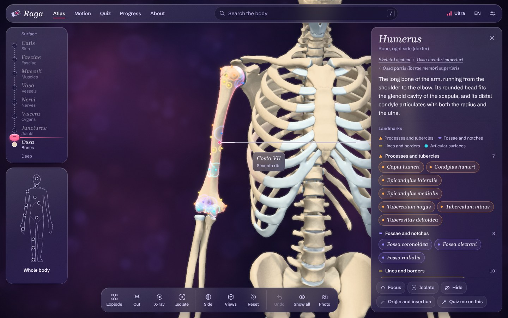

# Raga

Raga is a free 3D anatomy atlas with Latin short-answer quizzes. You can turn the body around, peel it layer by layer, click any structure for its Latin name and the facts you get examined on, watch a muscle contract and move its joint, then test yourself the way an OSPE station does: a pin on a specimen and an empty line for the name.

**Open it:** https://resvet.github.io/Raga/

It runs in the browser on laptops and phones, keeps working offline after the first visit, and can be installed to the home screen. There is no account and no tracking. Quiz progress stays on your device.



## What is inside

The model has 3,506 structures. Every bone is there with its landmarks placed on the surface (1,111 landmarks in all, including the borders and surfaces of the heart), along with the joints and their ligaments, capsules, discs and menisci, the muscles and tendons, 705 origin and insertion areas drawn on the bones, the heart with its valves and coronary vessels, arteries, veins, nerves, the airways and lungs, lymphoid organs and the skin regions.

### Atlas

- The depth gauge on the left peels the body from skin down to bone. Drag the handle to peel everything above it, or switch a single layer on or off.
- The body map below it frames a region: upper limb, knee, thorax, heart, larynx and others.
- The tray at the bottom has explode, a sagittal, coronal or transverse cut, x-ray (the rest of the body turns to glass), isolate, one side only, preset views and a photo button.
- Clicking a bone paints its landmarks on the bone in colour. Orange marks processes, tubercles and heads, violet marks fossae and notches, yellow marks lines, crests, borders and grooves, cyan marks surfaces and articular facets, and green marks foramina and canals. The list in the side panel uses the same colours and shapes, so it still works for colour-blind readers, and hovering a name flies the camera to that spot.
- Clicking a muscle and choosing "Origin and insertion" paints the attachment areas on the bones, red for the origin and blue for the insertion.

Each structure has a card with the Latin name (Terminologia Anatomica), the English name, a short description in English and Bahasa Indonesia, and the exam facts that fit it: origin, insertion, action, innervation with spinal roots, blood supply, joint class and shape, articulating surfaces, ligaments, nerve course and lesion patterns.

### Motion

The Motion tab plays the movements of the shoulder, elbow, radioulnar joints, wrist, hip, knee, ankle and subtalar joint, 26 movements per side. The bones turn about axes fitted to the real joint surfaces, and the muscles, vessels and nerves of that limb follow them. How far each point of a muscle follows depends on how close it lies to the moving bone compared with the bones that stay still. A muscle that runs from the trunk to the limb, such as latissimus dorsi or pectoralis major, keeps its origin on the trunk and is drawn out along its fibres toward its insertion. Prime movers glow pink, swell and shorten while their antagonists turn violet and stretch, so a biceps curl shows the biceps and brachialis working against the triceps. You can scrub, loop, change speed and switch between the right and left side. The rotations of the shoulder and hip are shown with the elbow or knee bent, the way they are tested.

97 muscles, heads and groups have their own clip, so a muscle card can play what that muscle does. Muscles that only move the fingers, the thumb or the scapula have no clip yet, because the hand and the shoulder girdle do not articulate in the rig.

### Quiz

The quiz follows the Blok 4 anatomy practicals at FK Universitas Sriwijaya (PA1 to PA8): general osteology, the skeleton of the upper and lower limb, the muscles of both limbs, the thoracic wall with larynx and airways, the heart and lungs, and the vessels and nerves of the limbs. A ninth deck holds 76 clinical cases. There are about 3,000 questions in all. Question types:

- name the highlighted structure, or the landmark at the pin, in Latin
- find a named structure on the model
- origin, insertion, innervation and action of a muscle
- joint type, axes of movement and ligaments of a joint
- bone type, the bones a bone articulates with, and the bone a landmark belongs to
- spinal roots of a nerve, and what a nerve, artery or bronchus arises from
- where a vein drains and what a vessel continues as
- the lobe of a lung segment
- clinical cases with one best answer: nerve injuries, fractures, dislocations, pulses, the chest wall, the larynx and the heart

You can type the answer or pick it from options. Typed answers are graded as short Latin text. Prefixes such as "M.", "N.", "Os" or "Lig." are optional, the bone name after a landmark is optional ("tuberculum majus" and "tuberculum majus humeri" both count), and a small spelling slip is accepted with a note. Words that are easy to mix up in an exam, such as externus and internus, major and minor, or coracoideus and coronoideus, are never treated as typos. In multiple choice the wrong options come from the same deck, from the same muscle compartment or the same bone where possible, and an option that could also be argued as correct is left out.

A wrong answer shows the right one, lights up the structure on the model and adds the description and the clinical note of that structure. A case shows its explanation and the structures it is about. Cards you miss come back sooner (spaced repetition), and the deck page offers the cards from all decks that are due today. The OSPE simulation gives a fixed number of seconds per station and shows the results at the end. A session you leave, by closing the tab or by looking something up in the atlas, can be continued where you stopped.

## Graphics

Raga picks a tier when it first opens on a device: Lite or High on phones and tablets, High on most laptops, and Ultra on computers with a dedicated graphics card or Apple silicon. You can change it at any time from the tier switch at the top of the page or in Settings, and "Auto" hands the choice back.

| Tier | Models | Effects | Download for all layers |
|---|---|---|---|
| Ultra | full source resolution, about 9.3 million triangles | soft shadows, ambient occlusion, depth of field, bloom | about 68 MB |
| High | lighter meshes | ambient occlusion, bloom | about 22 MB |
| Lite | simplest meshes | none | about 16 MB |

On a phone each layer downloads only when you open it, so the skeleton alone is a few megabytes. On a computer the joints and muscles also load in the background once the skeleton is up. Every tier has ambient occlusion baked into the vertices. The surfaces have no image textures; a shader adds the close-up detail instead, with porous bone, fibre striation along each muscle, wet tendons and cartilage, and light that scatters a little under the surface of muscle and organs. While you turn the model the frame gets cheaper, and full quality fades back in about a fifth of a second after you stop. If the browser drops the 3D view, Raga waits a moment for it to come back. If it stays lost, Raga steps down one tier, reloads and says so, and a quiz session in progress is offered again after the reload.

## Accuracy

The descriptions and exam facts were written from standard references (Moore's Clinically Oriented Anatomy, Gray's Anatomy for Students, Netter, Sobotta for the Latin) and the FK Unsri practical module. There are 1,832 written entries, covering the topics of all eight practicals: the bones, landmarks, joints, ligaments, muscles, vessels and nerves of both limbs, the skull and vertebral column with their joints and discs, the thoracic wall with its joints, muscles and intercostal vessels and nerves, the larynx, airways and lungs, the pleura and mediastinum, and the heart with its chambers, valves, coronary vessels, cardiac veins, pericardium and great vessels. Where the module uses a spelling or a convention that differs from Terminologia Anatomica (for example margo acutus and margo obtusus for the borders of the heart), the module's term is accepted as an answer and the card explains the difference.

A second pass checked the muscle facts (origin, insertion, action, innervation and roots), the joint classifications and the thorax entries against the references. The 31 entries where the sources disagree or are thin carry a notice in the app. The clinical cases were written from the same references and cover the classic correlations of the limbs and the thorax. If you find a mistake, or something that differs from what your lecturer teaches, follow your lecturer and open an issue here so it can be fixed for everyone.

## Bahasa Indonesia

Raga adalah atlas anatomi 3D dan kuis isian singkat berbahasa Latin yang gratis. Model bisa diputar, dikupas per lapisan, dan setiap struktur bisa diklik untuk melihat nama Latin, origo, insersio, aksi, persarafan, dan penanda tulangnya. Penanda tulang diberi warna sesuai jenisnya (prosesus, fossa, linea, permukaan sendi, foramen). Tab Gerak memutar animasi gerakan sendi bahu, siku, lengan bawah, pergelangan tangan, panggul, lutut, dan pergelangan kaki, lengkap dengan otot penggerak utama yang berkontraksi dan antagonisnya. Tingkat grafis dipilih otomatis sesuai perangkat dan bisa diubah kapan saja. Materi kuis mengikuti praktikum anatomi Blok 4 FK Unsri (PA1 sampai PA8), ditambah 76 kasus klinis. Jawaban bisa diketik atau dipilih dari pilihan ganda, ada simulasi OSPE dengan waktu per stase, dan sesi yang terputus bisa dilanjutkan. Antarmuka tersedia dalam bahasa Indonesia dan Inggris. Kalau menemukan kesalahan, buka issue di repositori ini.

## Running it locally

```bash
npm install
npm run dev      # development server
npm run build    # static site in dist/
npm test         # grader, decks, answer options, clinical cases, rig weights
npm run cases    # rebuild public/data/cases.json from content/cases
```

The site is plain static files. `BASE=/ npm run build` builds it for hosting at a domain root instead of `/Raga/`.

## How the data is made

Everything in `public/models` and `public/data` is generated from the Z-Anatomy Blender file by the scripts in `pipeline/`:

1. `export_pack.py` (run with the `bpy` Python module, Blender 5.2) evaluates each system and writes one glTF pack per system with world-space meshes and a canonical tissue material name. `RAGA_TIER=ultra` keeps the full subdivision and tube resolution.
2. `export_meta.py` reads the label leader lines to place every landmark on the bone surface (left-sided landmarks are mirrored and snapped to the left bone), maps the origin and insertion patches to their bones, and extracts the group tree and the encyclopedia texts. `fix_landmarks.py` then applies the hand corrections in `landmark_fixes.json` (the source file had the right and left surfaces of the heart swapped and no pin for the left border).
3. `build_catalog.py` attaches TA2 Latin names and the French, Spanish, Portuguese and Italian names.
4. `optimize.mjs` welds, simplifies (meshoptimizer), quantizes and compresses each pack, once per tier. Ultra is not simplified.
5. `bake_ao.mjs` ray-casts ambient occlusion into every vertex. `build_models.sh` runs steps 4 and 5 for all tiers.
6. `build_content.py` merges the hand-written entries in `content/` into `public/data/content.json`.
7. `build_cases.py` checks the clinical cases in `content/cases` and merges them into `public/data/cases.json`.

The renderer is three.js with a deferred ambient occlusion pass, shadow maps, selective bloom and depth of field. The motion rig fits joint axes from the bone geometry, works out skin weights for the soft tissue of a limb the first time that limb moves, and bends the tissue in the vertex shader. `docs/ENGINE_API.md` describes the engine and `docs/DESIGN.md` the interface.

## Credits and licences

- 3D models: [Z-Anatomy](https://github.com/Z-Anatomy/The-blend) by Gauthier Kervyn, Marcin Zielinski and Lluís Vinent, CC BY-SA 4.0, based on [BodyParts3D](https://dbarchive.biosciencedbc.jp/en/bodyparts3d/download.html) by The Database Center for Life Science, CC BY-SA 2.1 JP. Parts that Z-Anatomy took from non-commercial sources (inner ear, kidney) are not included.
- Latin and multilingual names: the Terminologia Anatomica 2 table shipped with Z-Anatomy.
- Encyclopedia texts: Wikipedia, CC BY-SA, as packaged by Z-Anatomy.
- Fonts: Schibsted Grotesk (The Schibsted Grotesk Project Authors) and Brygada 1918 (The Brygada 1918 Project Authors), both SIL Open Font License.
- Libraries: three.js, three-mesh-bvh, meshoptimizer, React (all MIT).

Raga's source code is under the [MIT licence](LICENSE). The models, data and written content in `public/models`, `public/data` and `content` are under [CC BY-SA 4.0](LICENSE-CONTENT.md), as the Z-Anatomy licence requires.

Made by Raffa Gamadan Rifandi ([ResVet](https://github.com/ResVet)), FK Universitas Sriwijaya, because education should be free.
